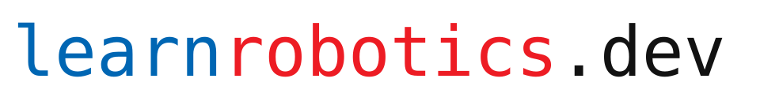

<p align="center">
  <picture>
    <source media="(prefers-color-scheme: dark)" srcset="./logos/learnrobotics.dev-dark.svg" />
    
  </picture>
</p>

<p align="center">
  <a href="https://learnrobotics.dev">learnrobotics.dev</a> · preview at <a href="https://preview.learnrobotics.dev">preview.learnrobotics.dev</a>
</p>

<p align="center">
  
  
  
  
  
</p>

This is a in development project for teaching FIRST programming

# Development

## Requirements

- [Rust](https://www.rust-lang.org/tools/install) (with the `wasm32-wasip2` target: `rustup target add wasm32-wasip2`)
- [Node.js](https://nodejs.org/) (LTS)
- [pnpm](https://pnpm.io/installation)
- [just](https://github.com/casey/just#installation)
- [Git](https://git-scm.com/downloads) (with submodule support)

## Cloning

```sh
git clone git@github.com:KennanHunter/learnrobotics.dev.git
```

If you clone without recursive, run

```sh
git submodule init
```

## Building

```sh
just # builds all our dependencies
just dev # runs a dev server on localhost:5173 
```

# Contributing

Contributions welcome! Approved changes will need to sign a CLA. Make an issue and describe what you're working before you put in too much work.

## AI

LLM Agents are allowed, but you gotta understand the code and be transparent about usage.

Exactly how much slop is allowed will change depending on page, ex: the compiler has to be solid, some random frontend page doesn't.

# License

This work is licensed under PolyForm Noncommercial License 1.0.0. You may read the full text in [LICENSE](./LICENSE)

## What does this mean

Anyone can run a free, noncommercial instance, including robotics teams, schools, and non-profits:

> Use by any **charitable organization**, **educational institution**, public research organization, public safety or health organization, environmental protection organization, or government institution is use for a permitted purpose regardless of the source of funding or obligations resulting from the funding.

(emphasis not part of license)

So if your team, school, or non-profit wants to host this, that's great! Feel free to reach out to `contact@kennan.dev` for help at any time.

If you want to make money off it (paid, subscription, or ad-supported), you'll need a license.

If you have any questions, or are interested in purchasing a commercial license, reach out to `licensing@kennan.dev`

(this is just a summary, the [LICENSE](./LICENSE) is what actually matters)
